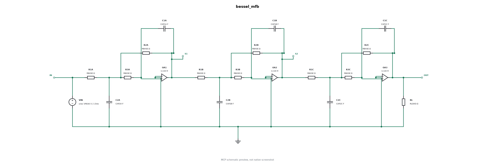
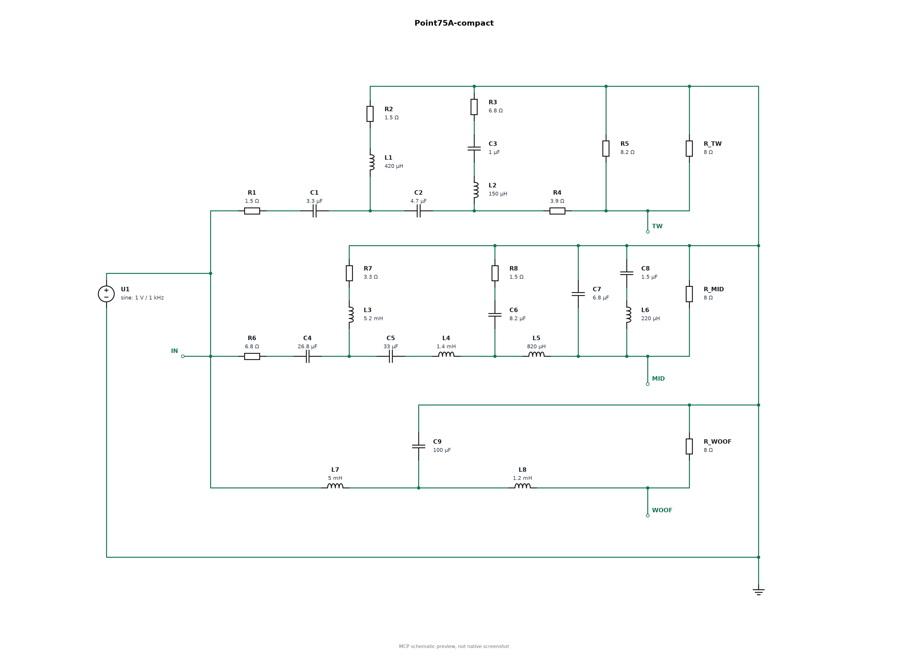

# FASTMEAN MCP

[](https://github.com/maxewka/fastmean-mcp/actions/workflows/ci.yml)

**Опишите электрическую схему обычным языком — получите готовый проект FASTMEAN и графики расчёта.**

Локальный MCP-сервер позволяет ИИ создавать и изменять родные `.scm`, соединять
элементы проводниками, собирать подсхемы и запускать численный расчёт в FASTMEAN.
Ключевые номиналы можно вынести в `.parameter`, а формулы графиков и короткие
пояснения сохранить прямо в схеме. Числа рассчитывает установленная FASTMEAN;
рисунок схемы и графики по этим данным строит MCP.

Графики приходят ИИ прямо через MCP как изображения. Сохранённый расчёт можно
показать в нужном масштабе, выбрать интервал и получить RMS, среднюю мощность
и пик через `fastmean_plot` — с PNG/SVG, измерениями и происхождением данных.

Есть готовые профили подключения для **Codex, Claude Code/Desktop, Kimi CLI
и DeepSeek через Cline**. Сервер использует стандартный протокол MCP stdio.
Работа идёт через файлы и пакетный запуск решателя, без управления окнами.

[Быстрый старт](#быстрый-старт) · [Усилитель](#пример-усилитель-на-четырёх-транзисторах) · [Автоматическая схема на 20 элементах](#автоматическая-компоновка-20-элементов) · [Графики через MCP](docs/PLOTTING.md) · [Другие ИИ-клиенты](docs/ai-clients.md) · [Все инструменты](#возможности-и-инструменты)

## Быстрый старт

### 1. Что потребуется

- **Windows** и отдельно установленная **FASTMEAN 6.1 или 6.0** для расчётов.
- **Python 3.12+** с `pip` и `venv`, доступ к загрузке Python-зависимостей.
- **Codex CLI** для автоматической установки в Codex. Другие клиенты можно
  подключить вручную — [инструкция](docs/ai-clients.md#install-without-codex).
- Git для клонирования. Также можно скачать репозиторий через **Code → Download ZIP**.

FASTMEAN устанавливается отдельно по своей лицензии. Этот репозиторий содержит
адаптер и примеры; установщик не скачивает программу, её решатели или шрифты.
Без FASTMEAN доступны создание, чтение и preview поддержанных схем, а также
графики по уже зарегистрированным нативным расчётам.

### 2. Скачать проект

В PowerShell или терминале Windows:

```powershell
git clone https://github.com/maxewka/fastmean-mcp.git
cd fastmean-mcp
```

При скачивании ZIP распакуйте его и откройте терминал в папке с `pyproject.toml`.

### 3. Установить и подключить к Codex

```powershell
py -3.12 distribution/install.py --dry-run
py -3.12 distribution/install.py
py -3.12 distribution/doctor.py
```

Первая команда показывает план. Вторая создаёт отдельную Python-среду,
устанавливает адаптер и добавляет сервер `fastmean` в настройки Codex.
Третья проверяет зависимости, путь FASTMEAN и настоящее соединение MCP.
Ожидаемый результат doctor: `ok: true`, `mcp_protocol.initialized: true`
и `mcp_protocol.tool_count: 22`.

По умолчанию FASTMEAN ищется в `%LOCALAPPDATA%\FASTMEAN 6.1`, затем в 6.0.
При другом расположении задайте путь явно:

```powershell
py -3.12 distribution/install.py --dry-run --app-dir "C:\Apps\FASTMEAN 6.1" --output-dir C:\FastmeanResults
py -3.12 distribution/install.py --app-dir "C:\Apps\FASTMEAN 6.1" --output-dir C:\FastmeanResults
```

Подставьте свой путь к папке с `Fastmean.exe`. Для пакетных расчётов используйте
папку результатов с ASCII-путём. Вместо `py -3.12` можно вызвать уже установленный
Python 3.12+ по полному пути. Настройки других MCP сохраняются; перед изменением
конфигурации создаётся резервная копия.

### 4. Переподключить MCP и выполнить первый расчёт

Перезапустите подключение MCP или приложение Codex. Отдельно запускать сервер
в терминале не нужно: клиент сам запускает его как процесс `stdio`.

Отправьте агенту, например:

> Проверь fastmean_status. Создай RC-фильтр: R = 1 кОм, C = 1 мкФ.
> Соедини элементы проводниками, проверь preview, построй АЧХ и ФЧХ
> от 1 Гц до 100 кГц. Верни готовый SCM и графики.

При подключённой FASTMEAN `fastmean_status` возвращает `installed: true`.
Результат запроса — новый файл схемы, нативные числовые данные, CSV и PNG графика.
Файлы исходной схемы сохраняются; каждый расчёт получает свою папку.

<details>
<summary><strong>Claude, Kimi, DeepSeek/Cline: ручное подключение</strong></summary>

После клонирования установите сервер в отдельную среду без Codex:

```powershell
py -3.12 -m venv .venv
.\.venv\Scripts\python.exe -m pip install .
```

Пример `stdio`-конфигурации. Замените три пути на реальные пути своего компьютера:

```json
{
  "mcpServers": {
    "fastmean": {
      "command": "C:\\path\\fastmean-mcp\\.venv\\Scripts\\python.exe",
      "args": ["-X", "utf8", "-m", "fastmean_mcp"],
      "env": {
        "FASTMEAN_APP_DIR": "C:\\Apps\\FASTMEAN 6.1",
        "FASTMEAN_OUTPUT_DIR": "C:\\FastmeanResults"
      }
    }
  }
}
```

Либо сгенерируйте конфигурацию для своего клиента:

```powershell
.\.venv\Scripts\python.exe -X utf8 -m fastmean_mcp.client_config --client kimi --app-dir "C:\Apps\FASTMEAN 6.1" --output-dir C:\FastmeanResults --write fastmean-kimi.json
```

Профили: `claude-code`, `claude-desktop`, `kimi`, `deepseek-cline`, `generic`.
В существующих настройках объедините только запись `fastmean`, сохранив другие
серверы. Ключ модели и вход в аккаунт настраиваются в ИИ-клиенте; серверу
FASTMEAN ключи поставщиков моделей не нужны.

[Куда поместить конфигурацию и как проверить каждый клиент →](docs/ai-clients.md)

</details>

Установку можно поручить агенту из открытой папки репозитория:

> Установи FASTMEAN MCP через distribution/install.py. Сначала проверь dry-run,
> затем выполни установку и doctor. Используй мою установленную FASTMEAN
> и существующий Python. Сохрани остальные настройки MCP и настройки Windows.

Обновление, удаление и дополнительные параметры — в
[руководстве установщика](distribution/README.md).

## Пример: усилитель на четырёх транзисторах

Запрос: **синус 1 кГц, вход 1 В RMS, выход около 25 В RMS и 500 Вт на 1,25 Ом**.
Питание усилителя — **±38 В**. Каждый транзистор представлен отдельной
редактируемой подсхемой с эквивалентной моделью. MCP создал схему с четырьмя BJT-подсхемами, физическими проводниками,
параметрами нагрузки и обратной связи, формулами напряжения, тока и мощности.


<details>
<summary>Что находится внутри транзисторных подсхем Q1–Q4</summary>


Каждый блок можно открыть и изменить: три сопротивления, два PWL-диода
и два управляемых источника тока. Это фиксированные авторские эквиваленты;
параметры и допущения описаны в [примере](examples/four-bjt-amplifier/README.md).

</details>

| Величина | Результат FASTMEAN в установившемся режиме |
| --- | --- |
| Входное напряжение | 1,000 В RMS |
| Выходное напряжение | 25,003 В RMS |
| Ток нагрузки | 20,002 А RMS |
| Средняя мощность нагрузки | 500,10 Вт |
| Входной ток | 66,8 мА RMS; 94,5 мА пик |

**Это учебный пример с приближёнными PWL-моделями.** Тепловая устойчивость,
пробой, SOA и высокочастотные эффекты не моделируются; результат не подтверждает
пригодность схемы для физической сборки на 500 Вт. Рисунок схемы отрисован MCP,
графики Matplotlib построены по числам штатного решателя FASTMEAN.

[**Открыть пример: файлы схемы, подсхемы, данные и повторение расчёта →**](examples/four-bjt-amplifier/README.md)

Чтобы попробовать после клонирования, попросите:

> Возьми examples/four-bjt-amplifier/Amplifier_4BJT.scm. Проверь соединения,
> рассчитай переходный процесс до 0,30 с с шагом 10 мкс и eps = 1e-5.
> Построй U(IN), U(OUT), I(RL), I(VIN), U(OUT)*I(RL).
> После fastmean_transient передай его run_id в fastmean_plot. Покажи
> 0,297–0,300 с, а RMS и среднюю мощность измерь на 0,29–0,30 с.
> Выведи входной ток в мА, добавь линию средней мощности и верни PNG/SVG через MCP.
> Объясни, какие параметры можно менять через .parameter.

В схеме сохранены пять выражений графиков и поясняющие TEXT. Папка `models`
должна находиться рядом с SCM. Для этого нелинейного примера используйте
переходный расчёт TD; частотные графики FD в примере отключены.

При изменении номиналов через `fastmean_edit_values` MCP сохраняет новую схему
вместе со всеми вложенными моделями. Переносите всю возвращённую папку проекта:
это позволяет открыть изменённый усилитель независимо от исходной папки.

Для изменения общей настройки используйте `fastmean_edit_parameters`, например
`updates={"Rload":2,"Rf":"3k","Vrail":40}`. Он меняет объявления параметров,
сохраняя привязки парных элементов, подписи и формулы. Это новый вариант схемы;
его режим нужно пересчитать. Обычный `edit_values` заменяет значение выбранного
элемента числом. [Параметры и чтение больших схем →](docs/PARAMETERS.md)

`fastmean_plot` выбирает точные столбцы сохранённого нативного CSV. Интервалы
`display_window=[0.297,0.3]` и `measurement_window=[0.29,0.3]` независимы;
`x_unit="ms"` меняет отображение оси. Для `I(VIN)` задайте `unit="mA"`,
`scale=1000`, `metrics=["rms","peak"]`; для `U(OUT)*I(RL)` —
`unit="W"`, `metrics=["mean"]`, `guides=["mean"]`. Измерения учитывают
неравномерные временные шаги, а новый график получает собственный `run_id`.
[Полные аргументы, формулы измерений и повторное открытие графика →](docs/PLOTTING.md)

## Автоматическая компоновка: 20 элементов

Три каскада фильтра Бесселя по топологии Texas Instruments SLOA049D:
**18 элементов исходной схемы плюс источник и нагрузка**. MCP сам выбрал
координаты: сигнальная цепь идёт слева направо, обратные связи расположены
над своими каскадами, шунтирующие элементы — снизу. Используются настоящие
ортогональные проводники и родные трёхвыводные символы `OPAMP`.



В SCM сохранены девять `.parameter`, формулы графиков и поясняющие TEXT.
FASTMEAN рассчитал 301 точку АЧХ и 5004 точки переходного процесса;
комплексная АЧХ совпала с независимым решением узловых уравнений с ошибкой
менее `1,6e-12`. Номиналы выбраны для учебного примера; `OPAMP` — идеальная
модель с конечным усилением, без ограничения питания, тока и полосы.

[**Готовый SCM, графики, источник топологии и повторение через MCP →**](examples/mfb-filter/README.md)

## Возможности и инструменты

Можно попросить: «Создай RC-фильтр с R=1 кОм и C=1 мкФ, проверь рисунок, построй АЧХ и ФЧХ от 1 Гц до 100 кГц и получи передаточную функцию. Затем открой схему в FASTMEAN».

Обычная последовательность: status → example → create → preview → inspect → AC / transient / symbolic. Для оформления численного результата: AC / transient → plot. Открытие окна выполняется отдельно через `fastmean_open`.

Доступно 22 инструмента:

| Инструмент | Назначение |
|---|---|
| `fastmean_status` | Установка, возможности, лимиты и активные операции |
| `fastmean_example` | JSON-примеры RC, RLC, делителя напряжения и flyback |
| `fastmean_create_circuit` | Новая родная SCM из элементов и узлов |
| `fastmean_create_project` | Переносимый проект с родными подсхемами и исходным JSON |
| `fastmean_annotate_circuit` | Параметры, поясняющий TEXT и сохранённые формулы TD/FD в новой копии |
| `fastmean_export_netlist` | Нативное раскрытие схемы и экспорт полного netlist с происхождением файлов |
| `fastmean_inspect` | Компоненты, соединения, порты и параметры SCM |
| `fastmean_edit_values` | Изменение номиналов в новой копии |
| `fastmean_edit_parameters` | Изменение существующих `.parameter` с сохранением общих привязок |
| `fastmean_relayout` | Перекомпоновка поддержанной цепи с физическими проводами |
| `fastmean_preview` | PNG и SVG схемы для визуальной проверки |
| `fastmean_ac` | Нативная АЧХ/ФЧХ, CSV и PNG графика |
| `fastmean_transient` | Нативный переходный процесс, CSV и PNG |
| `fastmean_plot` | График по сохранённому нативному run_id: PNG/SVG через MCP, интервалы, единицы, RMS/mean/peak и происхождение данных |
| `fastmean_symbolic` | Нативная символьная формула и передаточная функция |
| `fastmean_list_examples` | Поиск схем в установленной FASTMEAN |
| `fastmean_open` | Открытие рабочей копии штатной программой |
| `fastmean_search_manual` | Поиск по включённой справке возможностей |
| `fastmean_list_runs` | Сохранённые задания и результаты |
| `fastmean_get_result` | Результат по run_id, изображения и ссылки на файлы |
| `fastmean_read_data` | Страница числовых данных CSV |
| `fastmean_cancel` | Отмена принадлежащей серверу активной операции |

## Схемы и рисунки

Создание поддерживает R, C, L, независимый источник напряжения U/V и источник
тока I с постоянным, синусоидальным или импульсным сигналом. Узлы U/V задаются
как `[плюс, минус]`, узлы I — как `[from, to]`: положительный ток направлен от
первого узла ко второму. `0` — земля. Например,
`{"kind":"I","name":"I1","nodes":["0","out"],"value":"1m"}` задаёт
источник 1 мА из земли в `out`. Есть фиксированные нативные примитивы: диод `D`
с `parameters={Ron,Roff,Uon}`, управляемые источники `G/VCCS`, `E/VCVS`,
`F/CCCS` с четырьмя узлами в порядке родных выводов и числовым `value`. Их
нативные параметры — `g`, `k`, `h` соответственно. Имена — ASCII-идентификаторы.
Поддерживаются также нативный идеальный трансформатор `TR` (`n = Np/Ns`)
и ключ `SW`, управляемый напряжением (`Ron`, `Roff`, `Uon`, `Uoff`).
Для `TR` узлы идут как `[p1,p2,s1,s2]`, одноимённые выводы — `p1` и `s1`;
для `SW` — `[control+,control−,switch1,switch2]`, для `D` — `[анод,катод]`.
Родной трёхвыводный [`OPAMP`](docs/OPAMP.md) принимает
`[неинвертирующий,инвертирующий,выход]` и конечное усиление `k`.
Номиналы задаются в СИ или строками с суффиксами: `M` — мега, `m` — милли,
`u` — микро.

```json
{
  "components": [
    {"kind": "U", "name": "U1", "nodes": ["in", "0"], "value": 1, "waveform": {"kind": "sine", "frequency": "1k"}},
    {"kind": "R", "name": "R1", "nodes": ["in", "out"], "value": "1k"},
    {"kind": "C", "name": "C1", "nodes": ["out", "0"], "value": "1u"}
  ],
  "ports": ["in", "out"],
  "analysis": {"input": "in", "output": "out"}
}
```

Новые схемы используют соседние элементы, ортогональные провода и родные
соединительные узлы. Порты обозначают внешние входы и выходы. Для ручной
компоновки есть `layout.placements`, `layout.nodes`, `layout.ports` и
`layout.routes`: координаты кратны **4**, повороты — 0–3. Автоматические
интервалы остаются кратными 20; положение реальных выводов сохраняется точно.
`layout.nodes` задаёт подсказки для трассировки: лишний тупик к такой точке
может быть удалён после подключения выводов. Обязательную форму проводов
задавайте через `layout.routes`; координаты компонентов и портов — через
`placements` и `ports`.
`layout.ground_style="rail"` задаёт общую нижнюю шину земли по умолчанию;
`"local"` размещает отдельные родные GND у заземлённых выводов. Явные маршруты
узла `0` требуют режима `rail`.

Preview проверяет допустимость моделей и маршрутов, отклоняя неподдержанную
геометрию. Его PNG/SVG помечен `MCP schematic preview, not native screenshot`.
Проверяйте расположение элементов, подписи и провода по preview. Для плотной
схемы могут потребоваться ручные координаты или маршруты; автоматическая
компоновка не гарантирует совпадения с произвольным образцом.

[Набор внешних эталонных схем](benchmarks/reference-circuits/README.md) содержит
девять авторских транскрипций, аналитические ожидания и раздельные входы для
компоновки по образцу и автоматической расстановки. Численная правильность,
связность и визуальное сходство оцениваются отдельно; наличие входных JSON
само по себе не подтверждает прохождение нативных проверок.

[Point75A](examples/point75a/README.md) сохраняет расположение и все **25** R/L/C опубликованного кроссовера Troels Gravesen, Fig.31: [оригинальный PDF](http://www.troelsgravesen.dk/download/Point75A%26B.pdf). Четыре отдельно обозначенных компонента стенда — источник и три резистивные нагрузки — дают 29 элементов. Это электрическая модель фильтров: нагрузки 8 Ом не воспроизводят акустику динамиков. Оригинальные PDF и изображения не распространяются.



Это рисунок, построенный MCP по SCM, с читаемыми обозначениями; не снимок окна FASTMEAN. [Готовая схема](examples/point75a/Point75A.scm) открывается в программе.

## Flyback-преобразователь

`fastmean_example(kind="flyback")` возвращает готовую схему: 24 В, 50 кГц,
заполнение 40%, трансформатор 1:1, индуктивность намагничивания 200 мкГн,
выходной конденсатор 47 мкФ и нагрузка 20 Ом. Используются штатные `TR` и `SW`.
Индуктивность `LM` хранит энергию; идеальный `TR` сам по себе её не накапливает.

> Возьми fastmean_example с kind="flyback". Создай схему, проверь preview,
> рассчитай 10 мс с шагом 100 нс и eps=1e-5. Построй U(out), U(drain),
> I(LM), I(DOUT), U(gate). Через fastmean_plot покажи запуск и последние
> три периода, измерь среднее U(out) на 9–10 мс.

Проверенный результат FASTMEAN 6.1: **15,584 В** среднего выходного напряжения
на 9–10 мс. Это разомкнутая учебная модель без насыщения, индуктивности
рассеяния и паразитных параметров транзистора; земли обмоток служат общей
численной точкой отсчёта. Нативные состояния с одинаковым временем при
переключении сохраняются и обрабатываются штатными графиками MCP.

[Пример, SCM и графики](examples/flyback/README.md) ·
[Формат TR/SW, полярности и ограничения](docs/POWER-ELECTRONICS.md)

## Подсхемы и изменение проекта

`fastmean_create_project` принимает полный JSON проекта. `models` содержит определения с внешними выводами и собственной схемой; корневой `circuit` подключает их элементами `X`:

```json
{
  "models": {
    "RES": {
      "pins": {"Left": ["P"], "Right": ["N"]},
      "circuit": {
        "components": [{"kind": "R", "name": "R1", "nodes": ["p", "n"], "value": "1k"}],
        "ports": {"P": "p", "N": "n"}
      }
    }
  },
  "circuit": {
    "components": [
      {"kind": "U", "name": "U1", "nodes": ["input", "0"], "value": 1},
      {"kind": "X", "name": "BLOCK1", "model": "RES", "connections": {"P": "input", "N": "output"}},
      {"kind": "R", "name": "RL", "nodes": ["output", "0"], "value": "1k"}
    ],
    "ports": {"IN": "input", "OUT": "output"},
    "analysis": {"input": "IN", "output": "OUT"}
  }
}
```

Нумерация выводов блока идёт по сторонам `Left`, `Top`, `Right`, `Bottom`, внутри стороны — по списку. Все выводы должны иметь уникальные публичные ASCII-имена, точно совпадать с ключами `ports` определения и полностью присутствовать в `connections`. Поддержано до 99 моделей и 32 выводов на модель; ссылки могут быть вложенными. Активная рекурсия отклоняется до запуска решателя. Циклическая файловая ссылка через тестовый элемент с именем `_…` допустима: FASTMEAN исключает такие элементы внутри подсхемы, сохраняя их при самостоятельном запуске файла. Копирование и переименование проекта сохраняет эти ссылки. Определения могут не иметь внутренней земли: их внешние узлы подключает родитель. Числовой расчёт выполняет FASTMEAN по родным элементам, включая раскрытие `X`.

Нативная программа восстанавливает интерфейс по физическому положению и повороту PORT в дочерней SCM. Поэтому компилятор размещает их на объявленных сторонах и проверяет порядок координат; названий в `Pins` недостаточно. Ручные `layout.ports` должны сохранять эту сторону и порядок: `Left` — поворот 2, `Top` — 3, `Right` — 0, `Bottom` — 1. Несогласованная схема отклоняется. Для новой геометрии `X` используются стандартные шрифты и масштаб 100; относительная подпись файла модели ограничена 20 ASCII-символами.

Проект сохраняет `main.scm`, относительные `models/*.scm`, `project.spec.json`, отдельные JSON схем и манифест хешей. Для изменения номиналов или структуры подсхемы прочитайте опубликованный `project.spec.json`, измените JSON и снова вызовите `fastmean_create_project`. Получится новый проект; предыдущие файлы сохранятся. Нативные `.parameter`, `Scm/Actual` и переопределения параметров экземпляров этим API не создаются. Произвольный импорт SPICE/BJT-моделей не реализован.

Создание и пересборка не запускают окно и не используют управление компьютером. Для проверки применяются чтение SCM, MCP preview поддержанной геометрии и нативные пакетные расчёты. `fastmean_open` остаётся отдельной явной командой открытия окна.

Для ключевых номиналов и пояснений есть `fastmean_annotate_circuit`. Он принимает путь к SCM, `parameters` с числовыми/SI-константами, `bindings` от имён корневых R/C/L/U/I к именам объявленных параметров, список поясняющих `descriptions` и готовые `td_signals`/`fd_signals`. Например: `parameters={"R0":"1k","C0":"1u"}`, `bindings={"R1":"R0","C1":"C0"}`, `td_signals=["U(OUT)","I(R1)"]`, `fd_signals=["db(U(OUT)/U(IN))","phs(U(OUT)/U(IN))"]`. Для U/I связывается амплитуда постоянного или синусоидального источника. Добавляются родные TEXT-директивы параметров, обычные пояснения и активные выражения в настройках расчёта; геометрия и исходные файлы сохраняются. Зависимости подсхем копируются в отдельную рабочую папку. Параметры этого инструмента относятся к корневой схеме; переопределения параметров экземпляров `X` не создаются. Сам инструмент расчёт и GUI не запускает.

## Расчёты и результаты

FASTMEAN выполняет числовой расчёт через документированные скрипты. Matplotlib строит PNG по экспортированным нативным данным. Символьную формулу возвращает установленный `cirsymw.exe`; другим решателем она не подменяется. Preview схемы и график по данным имеют указанное происхождение и не являются снимками окна программы.

`fastmean_plot` читает зарегистрированный CSV завершённого AC/TD-расчёта,
проверяя его SHA256 по нативному манифесту. Формулы заново не вычисляются;
выбираются уже экспортированные столбцы. График возвращается как MCP
ImageContent и PNG/SVG-ресурсы; спецификация, измерения и манифест сохраняются
рядом. `fastmean_get_result` повторно возвращает изображение по `run_id` графика
после перезапуска. [Аргументы и ограничения →](docs/PLOTTING.md)

`fastmean_export_netlist` раскрывает схему штатной командой `save_netlist`, возвращая ограниченный текст, полный файл и манифест происхождения. Экспорт не запрашивает AC или переходный процесс. У экспорта и `fastmean_transient` есть `timeout` от 1 до 60 секунд, по умолчанию 60; он относится только к рабочему процессу данного запроса.

Исходные SCM сохраняются. Создание, редактирование, preview и расчёт получают отдельные папки. Нативная рабочая копия рекурсивно копирует зависимости подсхем, записывает хеши исходных и рабочих файлов, отключает окна графиков, развёртки и чтение сохранённого состояния; небезопасные файловые директивы отклоняются. `fastmean_open` явно открывает отдельную копию в GUI и также сохраняет зависимости и происхождение файлов. Существующие пользовательские окна сервером не управляются.

JSON-ответы ограничены по размеру; полный результат сохраняется отдельным файлом. PNG передаётся также как MCP ImageContent, файлы — как ResourceLink. Ресурсы:

- `fastmean://guide` — справка возможностей и нативных команд;
- `fastmean://runs/{run_id}` — сохранённый результат и каталог файлов;
- `fastmean://artifacts/{run_id}/{name}` — опубликованный файл задания.

Читать можно только опубликованные файлы соответствующего задания. Отдельное чтение ограничено 8 МиБ; большие CSV читаются через `fastmean_read_data` страницами по 200 строк, максимум 500 за запрос. Активные operation_id доступны в status; отмена относится только к созданным сервером процессам.

Страницы CSV и изображения повторно открытых результатов проверяются по SHA256.
Если сохранённый файл изменился, MCP сообщает об этом вместо выдачи его как
исходного результата. У численных расчётов проверяется весь запрошенный интервал,
а у АЧХ — также частотная сетка; незавершённый экспорт не считается успешным.

Перед переходным расчётом MCP ищет контуры из идеальных источников напряжения
и конденсаторов, включая соединения через вложенные подсхемы с проверенной
геометрией выводов. Тестовые элементы с префиксом `_` в дочерних схемах
исключаются так же, как при нативном раскрытии. Обнаруженная проблема объясняется
до запуска расчёта. Неизвестный интерфейс или предел раскрытия отмечается как
частичная проверка в манифесте. Это не полный анализ корректности модели;
частотный расчёт остаётся отдельной операцией.

У намеренно свободного вывода генератор ставит короткий провод и один родной
соединитель, как рекомендует FASTMEAN. Такой конец не удаляется при упрощении
дорожек; лишней нагрузки или внешнего PORT не добавляется.

| Переменная | Назначение |
|---|---|
| `FASTMEAN_APP_DIR` | Папка отдельно установленной FASTMEAN с Fastmean.exe |
| `FASTMEAN_OUTPUT_DIR` | Папка новых схем и результатов, вне установки приложения |

Приложение ищется в `%LOCALAPPDATA%\FASTMEAN 6.1`, затем 6.0. Установщик задаёт собственную папку `results`; при прямом запуске сервера используется `Documents\Codex\FASTMEAN-runs` текущего пользователя. MCP-клиент сам запускает stdio-сервер. Для разработки доступны `python -m fastmean_mcp` и console entry point `fastmean-mcp`.

## Ограничения и русский интерфейс

Лишние CON на изгибах удаляются, когда штатный проводник FASTMEAN точно
воспроизводит маршрут. Точки разветвлений сохраняются. В сложных обходах остаются
необходимые опорные CON: SCM хранит концы проводника, а не произвольную полилинию.
Preview отображает оставшиеся точки, включая опорные, как в нативной схеме.
`fastmean_annotate_circuit` принимает `td_signals=[]` или `fd_signals=[]` для очистки
соответствующих сохранённых графиков; `null` сохраняет прежние настройки.

Автоматическая расстановка по умолчанию компактная: `layout.density="compact"`.
Шаг вдоль сигнальной цепи уменьшен с 320 до 240, отступ ветвей — с 200 до 160
единиц. `layout.density="standard"` возвращает прежние интервалы. Параметр
`density` доступен и у `fastmean_relayout`; исходный файл сохраняется.
Ручные координаты остаются заданными пользователем и принимаются с шагом 4.
Размер символов сохраняется; длинные подписи нужно проверять на preview.

Символьный адаптер поддерживает линейные R/C/L, один независимый источник напряжения, выходной пробник и нулевые начальные условия. Для H(p) отрицательный вывод источника должен быть заземлён, а вход соответствовать положительному. Это не универсальный решатель произвольных уравнений. Символьная обработка I/D/G/E/F/X и автоматическая перекомпоновка таких схем не реализованы; `fastmean_relayout` поддерживает R/C/L/U. Источники I доступны для создания, изменения номинала, preview и численного расчёта. Старые бинарные SCM и произвольные нелинейные модели не поддержаны. Существующие схемы могут содержать модели, доступные числовому движку, но недоступные preview или символьному адаптеру. Ограничения DEMO задаёт установленная FASTMEAN.

Русский интерфейс старой ANSI-программы исправляет отдельный проект [FASTMEAN Russian UI](https://github.com/maxewka/fastmean-russian-ui), распространяемый своим установщиком. Его код, библиотеки и установщик отделены от MCP. MCP создаёт схемы и выполняет расчёты независимо от этого помощника; установка MCP не меняет интерфейс FASTMEAN или системную локаль.

## Разработка и проверки

[Результаты проверок](docs/validation.md). Большая схема проверена в родном окне FASTMEAN и независимым расчётом. В 1.0.1 исправлена публикация вложенных файлов через короткие Windows-пути DOS 8.3; проверки ссылок и выхода за папку задания сохранены.

```text
python -m pip install -r requirements-dev.txt
python -m pip install -e .
python -m pytest -q
```

CI настроен для Python 3.12 на Ubuntu и Windows без FASTMEAN. Нативные тесты там пропускаются: это проверка адаптера, а не сертификация движка. На Windows при наличии FASTMEAN тесты `test_engine` обнаруживают её автоматически. Для дополнительных настоящих stdio/relayout расчётов включите `FASTMEAN_MCP_NATIVE_TEST=1` и `FASTMEAN_RELAYOUT_NATIVE=1`. Они запускают установленную программу в отдельных рабочих процессах и сохраняют входные SCM.

Основные модули: `server.py` — MCP; `schematic.py` / `layout.py` — SCM и провода; `preview.py` — рисунок; `engine.py` — числовой CLI; `symbolic.py` — CIRSYM; `plotting.py` — графики и измерения сохранённых данных; `artifacts.py` — результаты и ресурсы. [Заметка о других инженерных MCP](docs/polish-review.md) объясняет принятые решения. Прохождение ещё не запущенного CI и совместимость со всеми установками не предполагаются: смотрите фактический журнал своего запуска.

Оригинальный код адаптера — [MIT](LICENSE). Зависимости и внешние материалы перечислены в [THIRD_PARTY_NOTICES.md](THIRD_PARTY_NOTICES.md). Отдельный русификатор имеет собственную лицензию LGPL-3.0-only. FASTMEAN остаётся отдельным приложением со своей лицензией. Основные источники: [информация и руководство](http://www.fastmean.ru/rus/index.php?page=info.php), [ссылки авторов](http://www.fastmean.ru/rus/index.php?page=links.php), [символьный анализ FASTMEAN](http://www.fastmean.ru/rus/index.php?page=symbolic.php).

## Проверки на внешних схемах

[Набор из девяти схем Masala-CHAI](benchmarks/reference-circuits/README.md)
проверяет компоновку по образцу и автоматическое размещение: 18 вариантов
созданы и рассчитаны через настоящий MCP. Все 18 АЧХ совпали с независимыми
уравнениями; прошли 14 поддержанных переходных расчётов. У ёмкостного делителя
переходный расчёт в FASTMEAN завершался по тайм-ауту — это ограничение явно
сохранено в отчёте. Номиналы, назначенные для проверки, отделены от напечатанных
в первоисточнике значений.

Галерея содержит наши MCP-рисунки; исходные сканы не распространяются.
Численные проверки и сравнение с рисунком учитываются отдельно.
