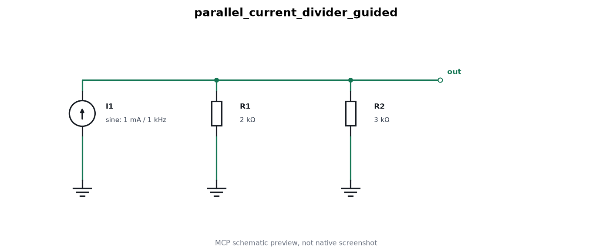
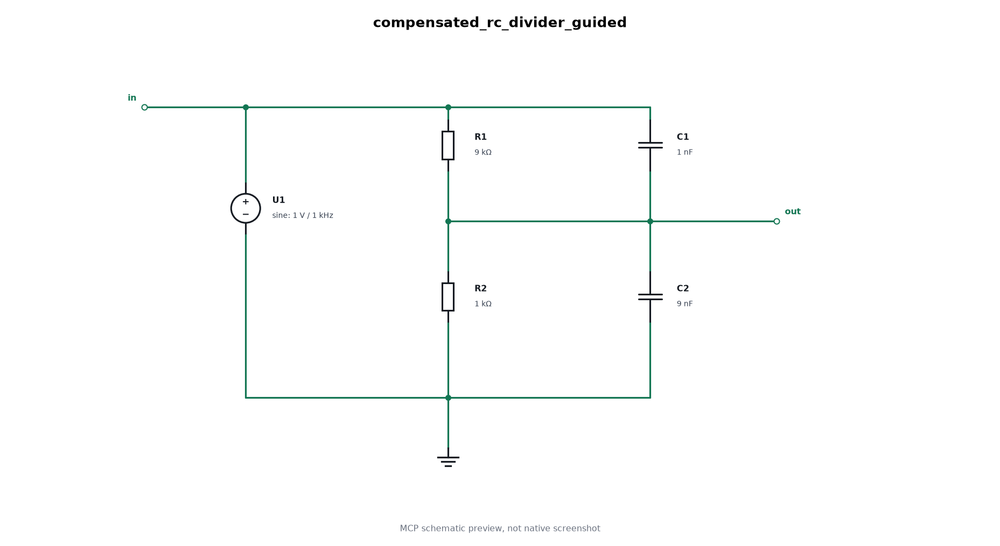
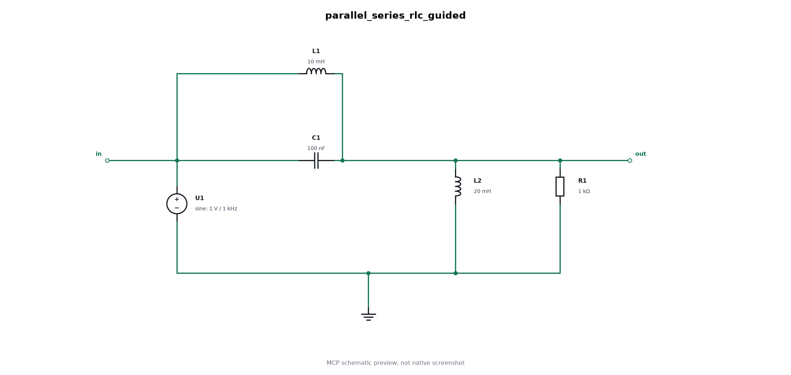
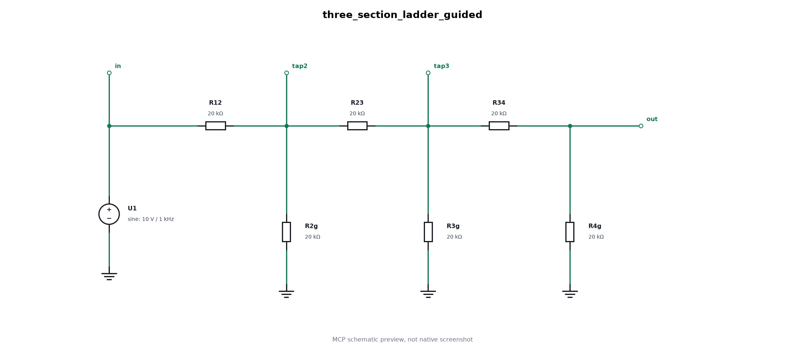

# External reference circuit benchmark

Nine original circuit transcriptions use schematic references from [Masala-CHAI](https://github.com/jitendra-bhandari/Masala-CHAI/tree/7478979675be02c61f22a137ecde64b0eadc0232/Dataset), pinned at `7478979675be02c61f22a137ecde64b0eadc0232`. Each case records the source path and image SHA-256. Original scans are not bundled: the repository has an [MIT software license](https://github.com/jitendra-bhandari/Masala-CHAI/blob/7478979675be02c61f22a137ecde64b0eadc0232/LICENSE), while the [paper](https://arxiv.org/html/2411.14299v5) describes textbook-derived schematics and individual image redistribution rights are unestablished.

These files contain authored inputs, independent analytical expectations and a [sanitized native validation report](validation-report.json). Every SCM construction, native netlist export and numerical calculation used the official MCP SDK over stdio.

| Case | Source within Dataset/data_5 | Main check |
| --- | --- | --- |
| thevenin-divider | 1.JPG | Series path and vertical load |
| norton-divider | 2.JPG | Upward current source and shared return |
| rc-lowpass | 3.JPG | Lowpass response and step charging |
| rc-coupling-highpass | 4.JPG | Series capacitor order and loaded highpass |
| parallel-current-divider | 5.JPG | Parallel branches with local ground glyphs |
| battery-divider | 6.JPG | Vertical resistor stack and 0.75 V output |
| three-section-ladder | 7.JPG | Repeated shunts and exact node voltages |
| compensated-rc-divider | 8.JPG | Aligned resistor/capacitor columns |
| parallel-series-rlc | 222.JPG | Parallel feed/load branches and response notch |

Each file has two complete MCP input specifications:

- `circuit_spec` uses logical placements on a 20-unit grid and external port positions. It has no mandatory node anchors or explicit routes.
- `automatic_circuit_spec` keeps identical components, ports and analysis, with compact density and the reference's rail/local ground style. It has no placement, node, route or port coordinates.

Pass the selected specification to `fastmean_create_circuit`. Actual SCM construction, inspection, native netlist export and analysis must use FASTMEAN MCP. Review its preview beside the private source reference; an MCP preview is not a native screenshot. Evaluate reference-guided and automatic variants separately. Graph equivalence, numerical agreement and visual fidelity are separate requirements.

`expected` contains independent equations, physical current directions, DC values and AC checks. Parameters are individually marked as printed or assigned. Only the battery divider and resistor ladder print all nominal source/passive magnitudes; AC stimulus frequency and source preparation are assigned test settings in every case. Assigned fixture results are not original textbook outputs. Frequency settings use logarithmic ranges; add analytical checkpoints when the sampled grid misses them. `validation-report.json` records applied tolerances. Verify native source-current signs before mapping physical directions onto exported columns.

Current-source cases use `kind: "I"` and `nodes: [from, to]`, with positive current flowing from ground upward into the output. Do not replace these sources with equivalent voltage-source networks. Native current column signs are checked separately from these physical directions. Battery references use circular ideal voltage sources in these inputs. Some references omit ground glyphs or use several local grounds. These remain explicit visual limitations or targets; a common physical return rail alone does not satisfy a local-ground reference.

The authored source waveforms are 1 kHz sines with the declared amplitudes, because DC-only sources do not excite native AC. For DC/step checks, `validate.py` creates a separate constant-source copy through MCP `fastmean_edit_values`; source values and connectivity stay the same. It uses the official MCP SDK over stdio for every native file and calculation. Native numerical samples are compared with independent complex nodal equations and closed-form step responses. Run it with the repository environment's Python; full replies, native provenance and generated files remain under ignored `local/` directories.

The RLC case has no finite steady DC operating point across its ideal inductor path. Its low-frequency gain is an AC limit. Use positive-frequency AC, including the 5032.92121045 Hz notch, for its primary numerical check. Phase at a response zero is excluded.

Native verification passed all 18 primary AC grids, both uncompensated secondary AC grids, both exact-notch magnitude checks, and all 14 supported transient checks. The compensated divider timed out in both layouts with DC excitation and again with a delayed finite-rise pulse. It remains an AC-only native benchmark; no transient or native DC pass is claimed for its ideal voltage-source/capacitor loop. Those failures are retained in the report. RLC transient checks are excluded for the reason above. General automatic readability and reference-guided fidelity were reviewed separately; automatic variants may choose a different clean branch orientation.

The gallery below contains our own directly returned MCP previews. It includes no original source-image pixels. These are drawings of native SCM objects, not screenshots of FASTMEAN. [Preview provenance and hashes](preview/manifest.json) identify the corresponding runs.

