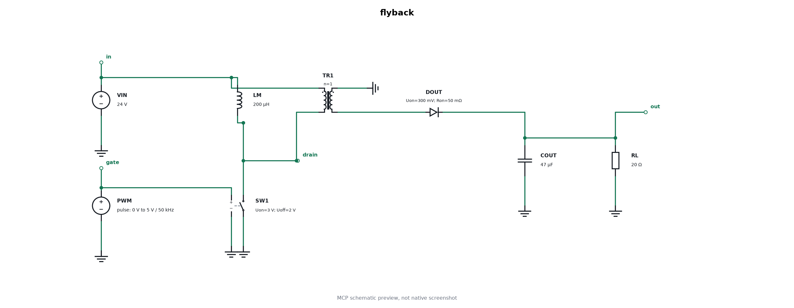
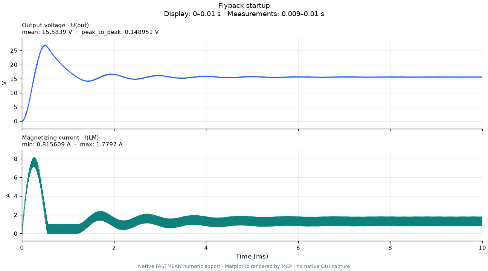
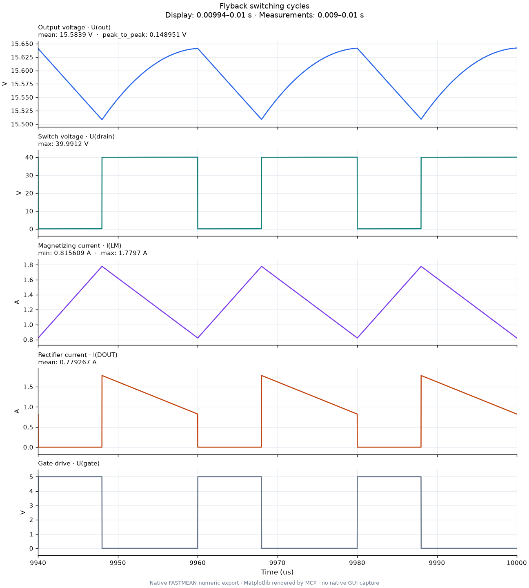

# Flyback на нативных TR и SW

Пример создаётся через `fastmean_example(kind="flyback")` и обычный
`fastmean_create_circuit`. Штатный решатель FASTMEAN 6.1 рассчитывает числа;
`fastmean_preview` рисует SCM, а `fastmean_plot` строит графики через Matplotlib.



Питание 24 В, частота 50 кГц, заполнение 40%, идеальный трансформатор 1:1,
индуктивность намагничивания 200 мкГн, выход 47 мкФ / 20 Ом. Источник PWM
управляет нативным ключом `SW`: пороги 3/2 В, сопротивления 0,05 Ом / 10 МОм.
Диод имеет порог 0,3 В и сопротивления 0,05 Ом / 10 МОм.

`LM` подключена параллельно первичной обмотке и накапливает энергию, пока
`SW1` замкнут. Вторичная обмотка включена с обратной полярностью, поэтому
`DOUT` проводит после размыкания ключа. Точки на `TR1` показывают одноимённые
выводы. Идеальный трансформатор без `LM` не является моделью flyback.

Это учебная модель с постоянным заполнением: без обратной связи, ограничения
пускового тока, насыщения, индуктивности рассеяния и паразитных параметров
транзистора. Обе обмотки имеют общую численную точку отсчёта `0`; пример
не моделирует плавающую вторичную сторону или свойства изоляции.

## Результат

Расчёт: 0–10 мс, шаг 100 нс, `eps=1e-5`. Полный нативный экспорт содержит
102 030 строк, включая адаптивные точки. Измерения выполнены на 9–10 мс.

| Величина | FASTMEAN 6.1 |
| --- | --- |
| Среднее выходное напряжение | 15,5839 В |
| Размах пульсаций выходного напряжения | 0,14895 В |
| Максимальное напряжение ключа | 39,9912 В |
| Минимальный / максимальный ток LM | 0,81561 / 1,77970 А |
| Средний ток выпрямительного диода | 0,77927 А |

Идеальная оценка для непрерывного тока — `24 × 0,4 / (1 − 0,4) = 16 В`.
Нативная модель учитывает падение на диоде и конечное сопротивление ключа.
Пусковой выброс на графике отражает отсутствие регулирования и ограничения
тока в этом примере.





## Файлы и воспроизведение

- [flyback.scm](flyback.scm) — самостоятельная схема с сохранёнными TD-выражениями.
- [circuit.spec.json](circuit.spec.json) — исходная спецификация для редактирования.
- [validation.json](validation.json) — запрос, покрытие временного интервала,
  сведения о решателе и численные измерения без локальных путей.
- [rebuild_via_mcp.py](rebuild_via_mcp.py) — создание, аннотация, preview,
  нативный netlist, transient и два графика через настоящий MCP stdio.

Запустите из корня репозитория с Python окружения MCP:

```powershell
python examples/flyback/rebuild_via_mcp.py --output-dir C:/FastmeanResults/flyback
```

Если FASTMEAN установлена нестандартно, добавьте `--app-dir` с её каталогом.
Каждый вызов создаёт новые зарегистрированные задания; исходные файлы
не перезаписываются. Полные нативные данные, CSV, provenance и результаты
появятся в указанном ASCII-каталоге. Скрипт напечатает путь к частному
`example-workflow.json`; этот журнал содержит локальные пути и не предназначен
для публикации.

Через MCP можно повторить команды из [основного README](../../README.md#flyback-преобразователь).
Для другой нагрузки, коэффициента трансформации или порогов ключа измените
JSON и создайте новую схему. [Порядок выводов и ограничения](../../docs/POWER-ELECTRONICS.md).
