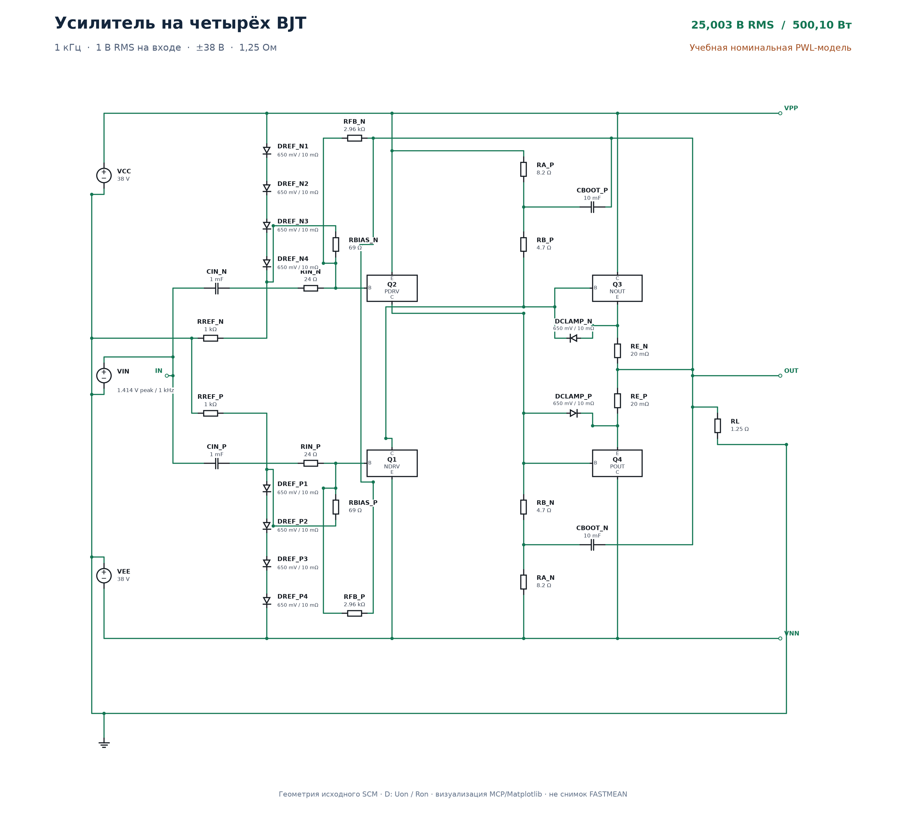
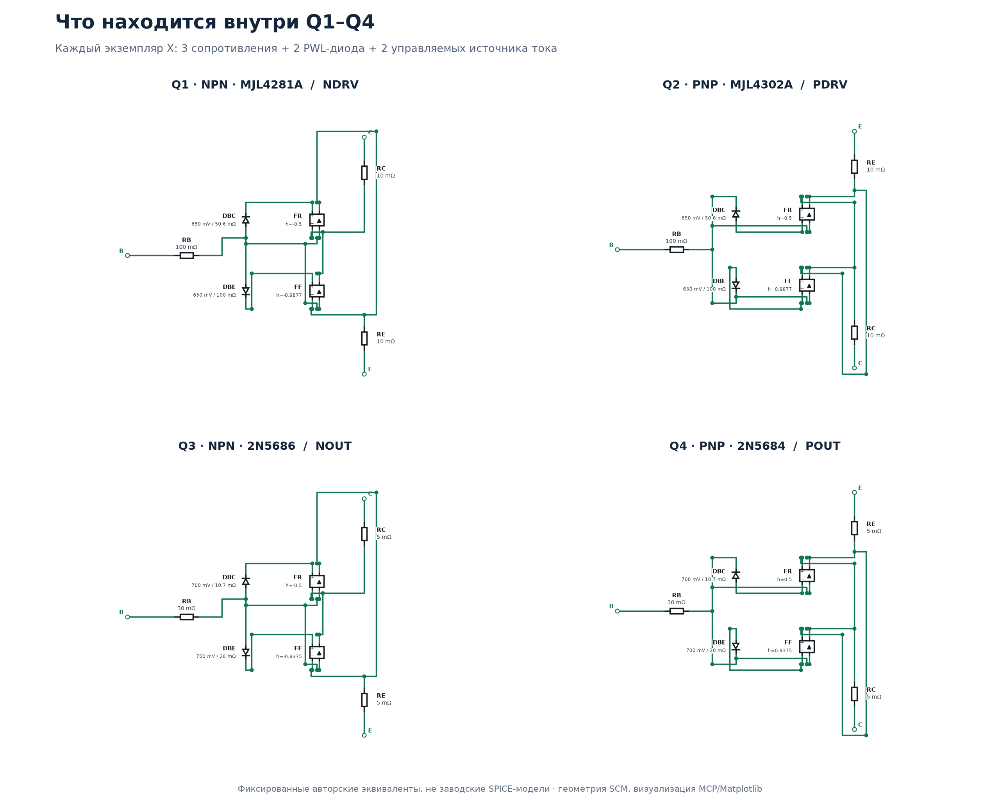
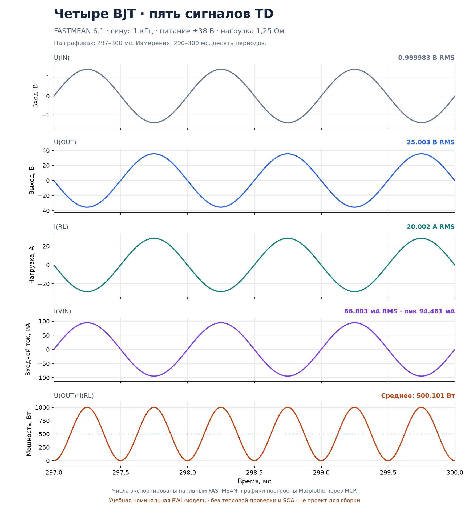

# Усилитель на четырёх BJT: номинальный расчёт около 500 Вт

Пример полного цикла FASTMEAN MCP: переносимый проект с четырьмя подсхемами, настоящие ортогональные провода, параметры схемы, нативный переходный расчёт и графики из его численных данных. При синусе 1 кГц, входе 1 В RMS, питании ±38 В и нагрузке 1,25 Ом получено **25,003 В RMS и 500,10 Вт** на нагрузке.

**Это учебная номинальная PWL-модель. Она не является проектом усилителя, готовым к аппаратной сборке на 500 Вт.**



Изображение построено средствами MCP/Matplotlib по координатам, выводам и проводам сохранённого SCM. Это не снимок окна FASTMEAN. В обзорной картинке скрыты длинные текстовые примечания; подписи параметров заменены их номинальными значениями. В скачиваемом SCM все примечания и `.parameter` сохранены.

## Файлы

Скачайте [репозиторий целиком](../../README.md) или сохраните эту папку вместе с `models/`. Для открытия нужен **[Amplifier_4BJT.scm](Amplifier_4BJT.scm)** и все четыре файла моделей:

| Файл | Содержание |
| --- | --- |
| [models/NDRV.scm](models/NDRV.scm), [models/PDRV.scm](models/PDRV.scm) | Номинальные PWL-эквиваленты драйверов Q1 и Q2 |
| [models/NOUT.scm](models/NOUT.scm), [models/POUT.scm](models/POUT.scm) | Номинальные PWL-эквиваленты выходных Q3 и Q4 |
| [project.input.json](project.input.json) | Исходная спецификация: `name`, `models`, `circuit`; численные определения, соединения и компоновка |
| [annotation.request.json](annotation.request.json) | Параметры и привязки, добавленные после создания проекта; путь указан относительно этой папки |
| [measurements.json](measurements.json) | Результаты с происхождением и настройками расчёта, без локальных путей |
| [native-transient-last10ms.csv](native-transient-last10ms.csv) | Последние 10 мс нативного экспорта и одна предшествующая строка для интерполяции границы |
| [waveforms.svg](waveforms.svg), [preview.svg](preview.svg) | Масштабируемые версии графиков и схемы |
| [SHA256.json](SHA256.json) | Контрольные суммы опубликованных SCM, моделей, спецификации и данных |

SCM, четыре модели и `project.input.json` перенесены без изменения байтов. Относительные ссылки `models/*.scm` должны сохраняться.

## Открыть и повторить через MCP

Сначала [установите и подключите FASTMEAN MCP](../../README.md). FASTMEAN 6.1 устанавливается отдельно. Затем дайте агенту запрос, подставив полный путь к своей копии:

> Проверь fastmean_status. Выполни fastmean_inspect для Amplifier_4BJT.scm из examples/four-bjt-amplifier с include_objects=true, затем fastmean_preview и fastmean_export_netlist. Запусти fastmean_transient для этой схемы с signals=["U(IN)", "U(OUT)", "I(RL)", "I(VIN)", "U(OUT)*I(RL)"], stop=0.3, step=1e-5, eps=1e-5. Измерь RMS и среднюю мощность на интервале 0.29–0.30 с с учётом неравномерной временной сетки. Покажи графики и происхождение результатов.

Минимальные аргументы нативного расчёта:

```json
{
  "path": "<полный путь к Amplifier_4BJT.scm>",
  "signals": ["U(IN)", "U(OUT)", "I(RL)", "I(VIN)", "U(OUT)*I(RL)"],
  "stop": 0.3,
  "step": 0.00001,
  "eps": 0.00001
}
```

`fastmean_transient` начинает с нуля и использует начальные условия конденсаторов из SCM. Начальный переходный процесс не включён в измерения. В сохранённых настройках SCM указан запас по времени до **0,5 с**; опубликованные результаты относятся к отдельному MCP-запуску до **0,3 с** с аргументами выше. Самостоятельное открытие SCM в FASTMEAN и расчёт TD также доступны.

Чтобы заново построить проект, передайте содержимое `project.input.json` как объект `spec` в `fastmean_create_project`. Затем примените `fastmean_annotate_circuit`: возьмите аргументы из `annotation.request.json`, заменив его `path` на путь нового `main.scm`. Создание проекта воспроизводит численную структуру и компоновку; текстовые параметры и сохранённые формулы добавляются отдельным шагом. Изменение численных определений моделей требует изменения `models` в спецификации и новой генерации: переопределения параметров дочерних экземпляров не поддерживаются.

## Что находится внутри

Верхний уровень содержит **ровно четыре транзисторных эквивалента Q1–Q4**. Они реализованы четырьмя родными экземплярами `X`, а не встроенными BJT или импортом SPICE. Каждая модель содержит три сопротивления, два PWL-диода и два управляемых источника тока. После раскрытия всей схемы: **60 элементов, 136 выводов, 43 электрических узла**. Сопоставление логических соединений JSON с нативным netlist подтвердило все 43 группы соединённых выводов без разделённых или случайно объединённых узлов.

| Экземпляр | Назначение | Номинальный ориентир | Файл |
| --- | --- | --- | --- |
| Q1 | Драйвер NPN | MJL4281A | NDRV.scm |
| Q2 | Драйвер PNP | MJL4302A | PDRV.scm |
| Q3 | Выходной NPN | 2N5686 | NOUT.scm |
| Q4 | Выходной PNP | 2N5684 | POUT.scm |



Это авторские приближённые эквиваленты с фиксированными коэффициентами, а не заводские SPICE-модели. Официальные справочные данные: [onsemi MJL4281A/MJL4302A](https://www.onsemi.com/download/data-sheet/pdf/mjl4281a-d.pdf) и [onsemi 2N5684/2N5686](https://www.onsemi.com/download/data-sheet/pdf/2n5684-d.pdf). Документы производителя и их изображения в пример не включены.

## Параметры и пять сохранённых графиков

В текстовом объекте под схемой сохранён настоящий заголовок `.parameter`. Изменяйте значения в копии SCM или применяйте `fastmean_annotate_circuit`, который создаёт новую переносимую копию.

| Параметр | Номинал | Привязка |
| --- | --- | --- |
| `Rload` | 1,25 Ом | RL |
| `Rfeedback` | 2958,192887903313 Ом | RFB_P, RFB_N |
| `Cinput` | 0,001 Ф | CIN_P, CIN_N |
| `Cbootstrap` | 0,01 Ф | CBOOT_P, CBOOT_N |
| `Rbias` | 69,04195248892718 Ом | RBIAS_P, RBIAS_N |
| `Vrail` | 38 В | VCC, VEE; полярность источников даёт ±38 В |
| `VinPeak` | 1,4142135623730951 В | Амплитуда VIN, то есть 1 В RMS при синусе |

Частота VIN — 1 кГц. Формулы TD уже записаны в SCM и имеют поясняющие текстовые примечания:

| Формула | Что показывает |
| --- | --- |
| `U(IN)` | Входное напряжение |
| `U(OUT)` | Выходное напряжение; усилитель инвертирует сигнал |
| `I(RL)` | Ток нагрузки |
| `I(VIN)` | Ток входного источника, с направлением отсчёта FASTMEAN |
| `U(OUT)*I(RL)` | Мгновенная мощность нагрузки; среднее за целое число периодов даёт выходную мощность |

## Полученные результаты

Нативный FASTMEAN 6.1 экспортировал численные значения. RMS и средняя мощность вычислены интегрированием по времени средствами NumPy на интервале **0,29–0,30 с**: границы интерполированы, затем применена формула трапеций на исходной адаптивной сетке. Графики построены Matplotlib из этого экспорта; изображение показывает последние три периода, а измерения используют десять периодов.

| Величина | Результат |
| --- | ---: |
| Входное напряжение RMS | 0,999983 В |
| Выходное напряжение RMS | **25,002515 В** |
| Ток нагрузки RMS | **20,002012 А** |
| Средняя мощность RL | **500,100725 Вт** |
| Входной ток RMS | 66,8034 мА |
| Пиковый модуль входного тока | 94,4609 мА |



Числа можно проверить без запуска FASTMEAN, установив зависимости репозитория и выполнив из его корня:

```powershell
python examples/four-bjt-amplifier/verify_results.py
python examples/four-bjt-amplifier/render_preview.py
python examples/four-bjt-amplifier/render_waveforms.py
```

Первая команда проверяет контрольные суммы, читает опубликованный CSV и проверяет основные измерения; это повторная обработка нативных данных, а не новый расчёт схемы. Вторая заново строит обзор схемы и четырёх моделей с помощью геометрии `fastmean_mcp.preview`. Третья строит все пять графиков из опубликованных столбцов CSV. Скрипты не меняют SCM и не запускают FASTMEAN. В `measurements.json` также сохранена исходная оценка THD по гармоникам 2–10; она зависит от интерполяции и параметров FFT и не является аппаратным измерением искажений.

## Границы применимости

Номинальный результат 500 Вт относится только к этой электрической PWL-модели. В ней нет тепловой обратной связи, SOA, пробоя, частотной зависимости коэффициента передачи и паразитных ёмкостей. Разброс β сильно меняет ток покоя; проверка устойчивости, защиты и физических режимов транзисторов не выполнена. Большие потери — дополнительная причина не переносить пример прямо в железо: оценка номинального режима составляет около 99 Вт на каждом выходном транзисторе, 65 Вт на каждом драйвере, 145 Вт на каждом RA и 40 Вт на каждом RB. Эти оценки потерь не входят в опубликованный пятиканальный CSV.

Обычный FD-расчёт этой нелинейной схемы не подтверждён; сохранённые формулы FD очищены. Для исследования частотной зависимости нужны отдельные установившиеся синусные TD-расчёты на разных частотах и анализ ограничений модели.

Новые схема, эквивалентные модели, спецификация, скрипты и иллюстрации распространяются по [MIT-лицензии репозитория](../../LICENSE). Проприетарный движок, шрифты, руководства и сторонние изображения сюда не включены.
