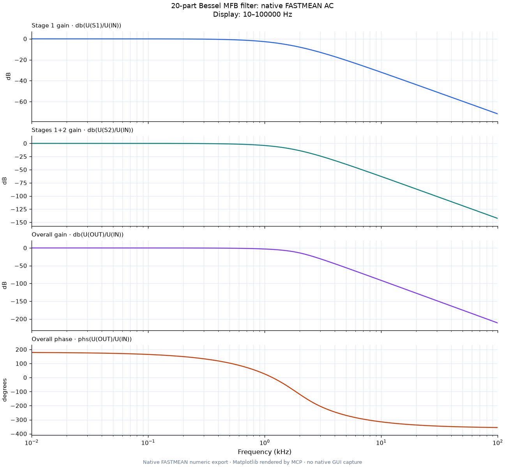
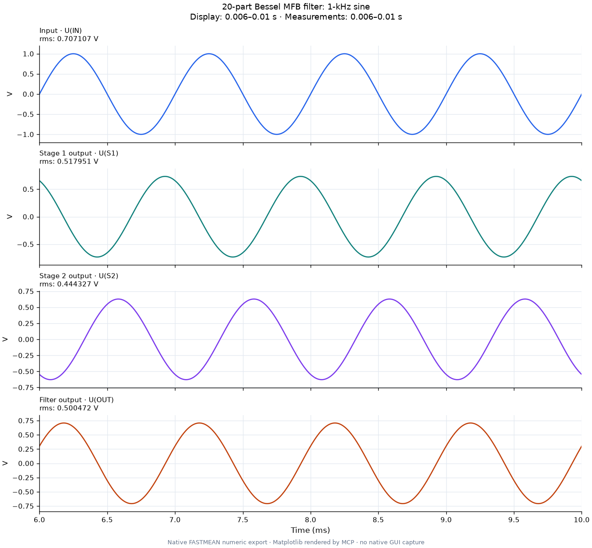

# Фильтр Бесселя: 20 компонентов, автоматическая компоновка

Готовая схема: [bessel_mfb.scm](bessel_mfb.scm). Три каскада идут слева направо;
обратные связи находятся рядом с соответствующим усилителем, шунтирующие
конденсаторы — под сигнальной цепью. Все соединения выполнены проводниками.
В JSON нет координат компонентов: размещение и трассировку выбрал MCP.


Основа — топология из Texas Instruments,
[SLOA049D, раздел B.2, рисунок B-2](https://www.ti.com/lit/an/sloa049d/sloa049d.pdf).
В ней **18 компонентов**: три операционных усилителя, девять резисторов и шесть
конденсаторов. Источник `VIN` и нагрузка `RL` добавлены для проверки: всего
**20 компонентов**. Исходное изображение TI здесь не распространяется.

Частота около 1 кГц и приведённые ниже номиналы выбраны для этого примера.
Усилители — родные идеальные трёхвыводные `OPAMP` с `k=1e8`, без ограничения
питания, тока, скорости и полосы. Это учебная модель фильтра, а не модель
конкретной микросхемы. Во всех каскадах `R1=R2=R3=10 кОм`.

| Каскад | FSF | Q | C1 | C2 |
|---|---:|---:|---:|---:|
| A | 1,6060 | 0,5103 | 6,473 нФ | 15,17 нФ |
| B | 1,6913 | 0,6112 | 5,132 нФ | 17,25 нФ |
| C | 1,9071 | 1,0234 | 2,718 нФ | 25,62 нФ |

Точные значения вычисляет [specification.py](specification.py). Источник:
синус 1 В амплитудного значения, 1 кГц. Нагрузка: 10 кОм. В схеме уже есть
блоки `.parameter`: `RBASE` меняет девять резисторов фильтра, `CAP1A`–`CAP2C`
задают шесть ёмкостей, `VPEAK` — амплитуду, `RLOAD` — нагрузку.

Сохранены формулы графиков и короткие пояснения TEXT:

- `U(IN)`, `U(S1)`, `U(S2)`, `U(OUT)` — вход и выходы трёх каскадов во времени;
- `db(U(S1)/U(IN))`, `db(U(S2)/U(IN))` — накопленное усиление первых каскадов;
- `db(U(OUT)/U(IN))` — АЧХ всего фильтра;
- `phs(U(OUT)/U(IN))` — его фаза в градусах.





FASTMEAN рассчитал 301 точку AC и 5004 точки TD. Независимое решение девяти
узловых уравнений, учитывающее конечный `k`, совпало с комплексной АЧХ с
максимальной абсолютной ошибкой менее `1,6e-12`. На 1 кГц общее усиление
составляет `−3,0021 дБ`. Проверка установившегося синуса также сравнивает
амплитуду и фазу. Подробности: [verification.json](verification.json).

Изображение схемы построено MCP из родных координат выводов и проводников;
это не снимок окна FASTMEAN. Графики отрисованы MCP/Matplotlib по числам,
экспортированным FASTMEAN. Параметры и TEXT присутствуют в готовом SCM;
пояснения скрыты только на обзорном изображении.

Для воспроизведения из установленного окружения проекта:

```powershell
python examples/mfb-filter/rebuild_via_mcp.py --output-dir C:\FASTMEAN-results\MFB
```

Скрипт использует официальный MCP SDK через stdio. Он создаёт новые
зарегистрированные задания, схему, параметры, формулы и графики, проверяет
числа и сохраняет исходный SCM. Управление окнами не требуется. Необязательный
`--publish-dir` копирует переносимую схему, изображения и проверку в новую
папку; существующую папку он не заменяет.
